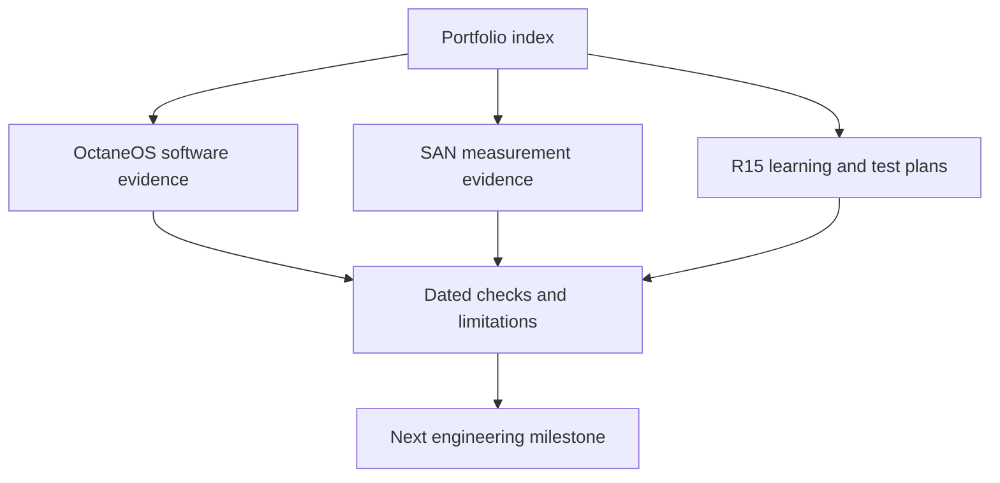

# Asphalt Sovereign — Engineering Portfolio

**Wajhudeen A | Automobile Engineering student | Chennai, India**

Evidence-led work in vehicle-data software, embedded acquisition and powertrain learning. This portfolio explains engineering choices and the limits of the available results.

## Start with these projects

| Project repository | Problem | Current evidence | Next milestone |
|---|---|---|---|
| [OctaneOS vehicle data intelligence](https://github.com/asphaltsovereign/octaneos-vehicle-data-intelligence) | Keep telemetry interpretation tied to source and data quality | Recovered Local 0.2 application, tests, lockfiles and synthetic examples | Reconcile SAN contract and reproduce a genuine bench import |
| [SAN-V1 automotive data acquisition](https://github.com/asphaltsovereign/san-v1-automotive-data-acquisition) | Build a traceable low-cost measurement chain | Actual bench firmware and validator; early USB/serial work recorded | Repeated calibrated bench log and power-loss evidence |
| [R15 V2 powertrain engineering](https://github.com/asphaltsovereign/r15v2-powertrain-engineering) | Establish a controlled stock baseline before calibration claims | Study notes, dimensional calculations and unexecuted test plan | Approved instrumentation and stock-fuel stationary baseline |

The repositories belong to the [asphaltsovereign engineering profile](https://github.com/asphaltsovereign). Source recovery and software verification are separate from physical vehicle validation.

Read the [OctaneOS case study](case-studies/octaneos.md), [SAN-V1 case study](case-studies/san-v1.md), [powertrain case study](case-studies/r15v2.md), [public CV](cv/Wajhudeen_A_Engineering_CV.md) and [evidence standard](docs/evidence-standard.md).

## 1. Problem

Scattered project files make it difficult to see a student's contribution, design reasoning and test evidence. This repository supplies one technical index with defensible status labels.

## 2. Automotive relevance

An engineering reviewer should be able to follow requirements → design → implementation → test → result → limitation without relying on promotional claims.

## 3. Requirements

Separate source repositories; ten-question READMEs; source provenance; stated dependency/hardware requirements; diagrams; synthetic public examples; dated results; explicit open issues; current, meaningful commits.

## 4. Architecture

One profile points to this index. This index points to case studies and specialist repositories. Each specialist repository owns its implementation, tests and results. Research proposals and institutional work have a separate private inventory until attribution and disclosure are resolved.

## 5. Selection rationale

OctaneOS demonstrates software/data reasoning; SAN-V1 exposes instrumentation and validation requirements; R15 work connects them to a disciplined powertrain-learning program. One coherent chain is easier to assess than a large catalogue of unsupported product claims.

## 6. Implemented

This consolidation provides the index, public CV, three case studies, evidence rules and recovery/publication records. The website already has a separate existing repository, `Asphalt-Sovereign/digital-headquarters`; this work does not redeploy it.

## 7. Testing

Local relative links and required files are checked in the workspace verification. Software-specific test results live with their source repositories. A document link check is not a vehicle or commercial test.

## 8. Actual results

See [reports/consolidation-status.md](reports/consolidation-status.md) for the publication record and evidence boundaries. Public-data experiments, simulations and proposed work are not merged into one maturity claim.

## 9. Limitations

No current paid pilot, production customer deployment, validated motorcycle diagnosis or tuning improvement is established by this portfolio. Some recovered team research has unresolved ownership/disclosure status and is not published as solely company-owned.

## 10. Next engineering milestone

Produce one genuine, calibrated SAN bench session and trace it into a reproducible analysis report. That closes an engineering evidence gap and is more valuable than expanding the repository count.

## Installation, assets and dependencies

This repository is Markdown documentation: no install, hardware or software dependencies. View it on GitHub or locally. Demonstration screenshots and synthetic datasets are held in the relevant project repository with their provenance, rather than duplicated as new evidence.

Contact: [asphaltsovereign.com](https://asphaltsovereign.com). The CV uses professional information and omits phone number, private location, identifiers and personal academic records.
